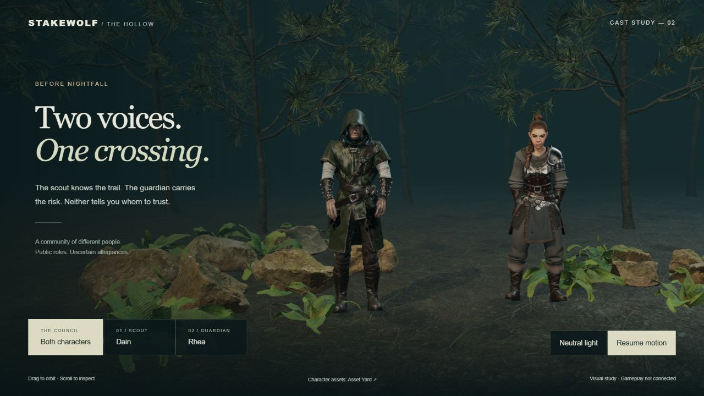
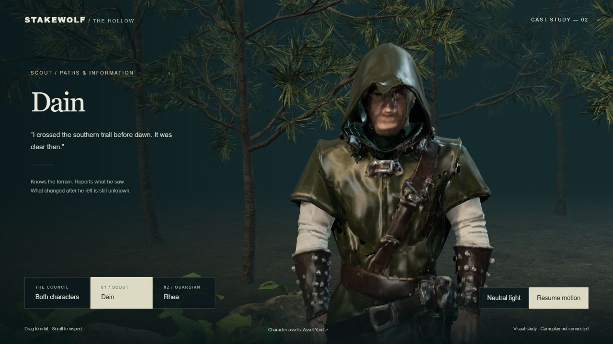
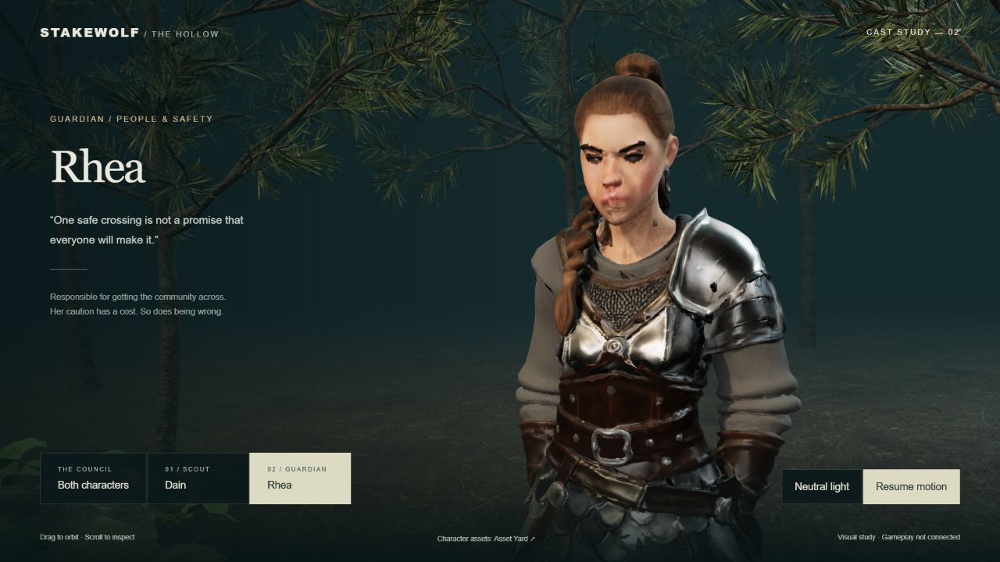

# SCRUM-36 — two-character council study

October 15, 2026. Owner approved a small cast-diversity scene after rejecting the wolf face and questioning an all-wolf community. This is an isolated evaluation at `http://127.0.0.1:4180/`, not an integrated game or accepted cinematic art.

Coordinator authored `public/wild/cast-proof/` and `scripts/serve-cast-proof.mjs`; `cast_gate` independently reviewed sources, syntax, asset provenance and actual screenshots. No other worker was used for this increment.

## Delivered

- Two separately animated human characters with different silhouettes: hooded scout Dain and armoured guardian Rhea.
- Shared woodland staging, council/individual camera views, orbit inspection, dusk/neutral lighting and pause/resume.
- Public responsibility is distinct from allegiance. No hidden faction is assigned by this proof. The quoted lines are static context, not branching conversations.
- [Setup, original download links, hashes and licensing boundaries](../../public/wild/cast-proof/README.md). Raw models remain ignored locally; the public checkpoint contains source, bundle and rendered evidence only.

## Actual visual result

Both close-ups **fail the cinematic art gate**. Dain has muddy/obscured eyes and mouth; Rhea has malformed eyes/lips. Surface detail and armour do not compensate for facial defects. Dain's hidden face also reads more suspiciously; a final cast must not turn a clothing choice into a reliable faction cue. The useful result is the two-character cast comparison and a bounded rejection of these faces, not production-quality character delivery.

## Verification and independent review

- Coordinator loaded both original GLBs in the actual desktop browser. Both `idle` clips ran; original clip names and Head bones were observed. Together, scout and guardian views rendered. Pause/resume and dusk/neutral switching worked; Enter activated the lighting button.
- New source and preview-server syntax checks passed. The bundled scene was rebuilt with existing pinned repository dependencies.
- Browser emitted one PMREM shader precision warning. It did not prevent rendering; this is not a warning-free or cross-device result.
- `cast_gate` independently reviewed all three rendered captures and both scripts. Conditional pass for isolated cast-direction evaluation; cinematic acceptance failed.
- Reviewer P2: unconditional `pagehide` disposal could leave a browser-cached page inert on Back. Corrected to suspend the frame loop when persisted, resume on persisted `pageshow`, and dispose only when leaving permanently. `cast_gate` re-reviewed the final source, narrow capture, README and handoff: no remaining blocker for the isolated evaluation checkpoint. Actual cached restoration was not forced or tested. Cinematic acceptance and production integration remain rejected.
- Narrow settings buttons retain a minimum 44 px target. Inspection at 390 × 844 found cropped characters and a missing space in the heading; the narrow camera field of view and heading spacing were corrected. [Narrow capture](local-scrum36-council/narrow.png).
- Seven bounded HTTP checks passed: HEAD requests for the page, stylesheet, bundle and both models returned 200 with expected types/lengths; an unlisted model returned 404 and POST returned 405. The initial sandbox socket check was denied; the permitted local-only rerun passed.
- Final bundle: 660,754 bytes. Weekly account meter: 25% at start, 27% near completion; this is account-wide and does not attribute exact usage to this chat. No measured activity hours are claimed.

No full-game suite, CI, benchmark, physical-phone, facial animation, new story, dynamic inputs or release approval is claimed. Local browser checks do not establish broad performance. The 22,976,120-byte character payload is significant for a desktop study.

## Handoff

Keep SCRUM-36 In Review. Show the actual comparison to the owner and stop. Do not integrate or repeatedly polish these faces. Any next candidate should have a convincing face demonstrated in an unretouched close-up before implementation. All-wolf casting is superseded by a varied community direction; hidden allegiances must remain independent of public role and appearance. November 6/13 targets remain at risk. No schedules, purchase or reset credit were used.
