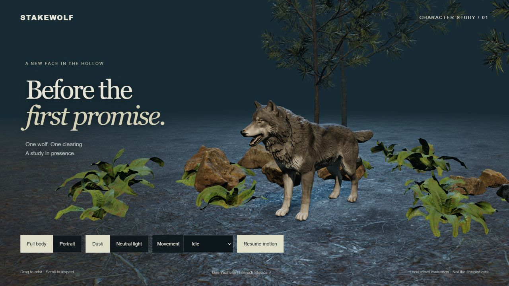
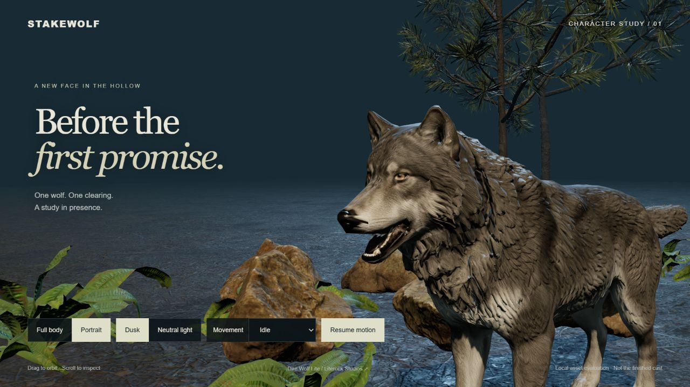
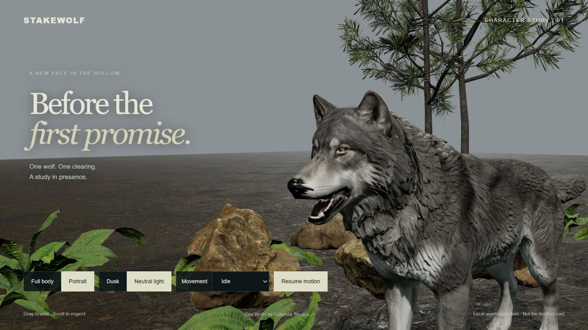

# SCRUM-36 — one-scene wolf comparison, October 15, 2026

The owner rejected the preceding portrait/fur direction and explicitly selected an asset-first fallback: find a better wolf, show one small scene, conserve usage and stop before another polish loop. This checkpoint implements that bounded evaluation. It does not approve the character or replace the main game.

## Result

[Dire Wolf Lite by Literock Studios](https://literock-studios.itch.io/direwolf-lite) is loaded locally with its original mesh, materials, rig and supplied idle/walk animations. Three pines, two rock placements and three fern placements reuse the existing scenery. Two cameras and two lighting settings expose both shape and texture quality. The only visual follow-up was reducing the distracting ground texture scale/strength; no model repair or fur work was attempted.

Actual browser captures, 1280 × 720, without retouching:

The face, ears, eyes and muzzle are visibly more natural than [the preceding Vela](local-scrum36-portrait/vela-after.png). The coat still reads carved/scaly, the mouth is stiff, and a black wedge is visible at the nose. The clearing is a simple inspection setting. These limitations are deliberately recorded rather than obscured with effects. No final cinematic quality or production suitability is claimed.

## Independent review and verification

- Author/integration/browser inspection: coordinator. Independent reviewer: `asset_gate`, read-only source, asset/license and screenshot comparison. Reviewer did not independently inspect live playback.
- Reviewer disposition: **approve for local evaluation only**, after replacing the removed `PCFSoftShadowMap` setting. The source now uses `PCFShadowMap` and the bundle was rebuilt. No blocking defect found for this bounded proof; no artistic approval.
- Reviewer independently parsed 35 joints and four animation clips and passed syntax checks for both authored JavaScript files. The coordinator rebuilt the bundle and repeated those syntax checks successfully.
- Coordinator inspected actual idle motion, walk-in-place pose changes, pause/resume, camera switching and both lights. Pausing retains the visible model. Final load emitted the expected asset/clip metadata; no new warning/error after the shadow setting rebuild. The earlier deprecation warning remains in the tab's historical log.
- HTTP checks: preview GET 200; model HEAD 200 and 12,437,756 bytes; `.git/config` and traversal to README 404; model POST 405. The exact model route is served from an ignored folder; listener is loopback only.
- No full main-game regression suite was rerun because the proof does not edit main-game files. No mobile visual or device-performance acceptance is claimed.
- One candidate download and one independent reviewer. Weekly account meter observed 20% at start and 24% at the closing checkpoint; account-wide readings cannot precisely attribute usage to this chat. No purchase or reset credit used. No activity-hours claim.

## Handoff

Local preview: `http://127.0.0.1:4179/`. [Setup and licensing](../../public/wild/wolf-proof/README.md). Existing game remains `http://127.0.0.1:4174/wild/`.

Raw licensed assets are excluded from publication. Continue the existing draft [PR22](https://github.com/sadhirr1/Stakewolf/pull/22) from verified parent `9bb8cce9ebea27698a28308047af86dd58d264e6`, publishing only the explicit proof/evidence/handoff manifest. The root checkout's unrelated changes remain preserved.

Next action: owner judges this actual scene before integration or further asset work. If the coat/face still miss the target, do not launch another shader-polishing session on this model. SCRUM-36 remains In Review. November 6/13 delivery targets remain at risk; work-session and scrum automations stay off.
